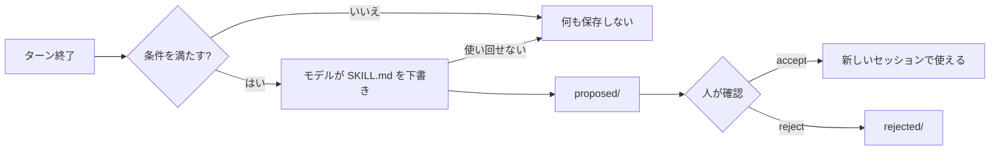
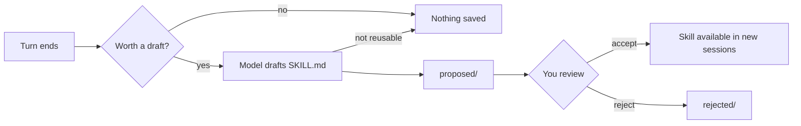

# dsh-skill-scribe

[](LICENSE)


[日本語](#日本語) | [English](#english)

## 日本語

[DeepSeek Harness](https://github.com/deepseek-ai/deepseek-harness)（dsh）のプラグインです。ターンが終わるたびに作業内容を見て、繰り返し使えそうなら `SKILL.md` の下書きを作ります。下書きは `accept` するまで読み込まれません。

> 自分で使うために作ったプラグインなので、至らないところがあると思います。README は AI で書きました。

Hermes のようにスキルを自動で保存して使い回す方式は便利ですが、知らないうちに保存されたスキルが別の作業で読み込まれると困ることがあります。そこで、候補の保存は自動のまま、有効にするかどうかだけ人が決める形にしました。

### できること

- ツールを 3 回以上使って完了したターンから、スキルの候補を作ります（回数は設定で変えられます）。
- 既存のスキルを使ったターンでは、そのスキルの更新案を作ります。`diff` で変更点を確認できます。
- モデルに送る前とファイルに書く前に、API キーのように形で見分けられる秘密を伏せます。
- 下書きにはセッションと同じモデルを使います。OpenAI 互換のローカルモデルでも動きます。
- プラグイン自身はコマンドを実行しません。

### 仕組み



### 必要なもの

- Node.js 20.3 以降
- dsh `>=0.2.0-rc.2 <0.3`（`0.2.0-rc.2` と `0.2.1-rc.5` で確認済み）
- [pnpm](https://pnpm.io/)（`dsh plugin` が使います）

### インストール

```sh
git clone https://github.com/MaresaN41/dsh-skill-scribe.git
dsh plugin --profile <profile> add /absolute/path/to/dsh-skill-scribe
```

`<profile>` は使っている dsh のプロファイル名に、パスは clone した場所の絶対パスに置き換えてください（例: `dsh plugin --profile headless add /home/you/src/dsh-skill-scribe`）。パッケージの `dsh.bundle.patch` で自動的に登録されるので、`--patch` を足す必要はありません。

### クイックスタート

dsh のセッションで、ツールをいくつか使う作業を実行します。ターンが終わると、バックグラウンドで候補が作られます。

```sh
cd dsh-skill-scribe
node bin/scribe.js list
```

```text
id                     kind  created                   drafter  task
csv-aggregate-by-date  new   2026-11-04T22:44:10.340Z  llm      Sum amount by date ...
```

中身を読んで、承認か却下を選びます。

```sh
node bin/scribe.js show csv-aggregate-by-date
node bin/scribe.js accept csv-aggregate-by-date
```

承認したスキルは次のセッションから使えます。候補は次のような形です。

```markdown
---
name: csv-aggregate-by-date
description: "Aggregates numeric columns in a CSV file by grouping on a date column"
whenToUse: "When summarizing transactional or time-series data by calendar date"
---

# CSV Aggregate by Date

## Steps
1. Read the input CSV file to extract date and amount columns
2. Group rows by the date column
3. Sum the amount values for each unique date
4. Write the aggregated data to a new CSV file

## Notes
- Works with any CSV where one column is a date and another is numeric
```

下書きは依頼文の言語で作られます。`language` で指定もできます。

### 候補が作られないとき

次のすべてに当てはまるときだけ、候補が作られます。

- ターンがエラーなく完了している。
- ツールを `minToolCalls` 回以上使っている（スキルの読み込みは数えません）。
- モデルが使い回せる手順だと判断している。
- 下書きが形式の検査を通っている（やり直しは 1 回です）。
- その日の上限に達していない。
- 同じセッションで前の下書きが動いていない（動いている間に終わったターンは飛ばします）。
- プロセスが終わる前に下書きが完了している。

### コマンド

リポジトリでは `node bin/scribe.js <コマンド>`、プロファイルの `node_modules/.bin` からは `scribe <コマンド>`、dsh の中では `/scribe <コマンド>` で実行します。

| コマンド | 説明 |
| --- | --- |
| `list` | 承認待ちの候補を一覧にする |
| `show <id>` | 候補とメタデータを表示する |
| `diff <id> [--project <dir>] [--dest <dir>]` | 候補と今のスキルを比べる |
| `accept <id> [--project <dir>] [--dest <dir>]` | 候補をスキルとして置く |
| `reject <id>` | 候補を `rejected/` へ移す（消しません） |

`accept` の保存先は既定では `$DSH_HOME/skills`、`--project <dir>` なら `<dir>/.dsh/skills`、`--dest <dir>` なら指定した場所です。同じ名前のスキルがあれば、先にバックアップを取ります。

更新案の保存先も同じです。元のスキルが別の場所にあるときは元のファイルは変わらず、`accept` の出力でそれを知らせます。プロジェクトのスキルを更新するなら、`accept my-skill-update --project /path/to/project` のように保存先を指定します。

### 設定

設定はすべて省略できます。

| 設定 | 既定値 | 説明 |
| --- | --- | --- |
| `enabled` | `true` | プラグインの有効・無効 |
| `minToolCalls` | `3` | ターンに必要な最小のツール回数。スキルの読み込みは数えない |
| `model` | セッションのモデル | 下書きに使う `{ provider, model }` |
| `endpoint` | なし | 予備の OpenAI 互換の接続先 `{ baseURL, model, apiKeyEnv }` |
| `language` | `"auto"` | 下書きの言語。`auto` は依頼文に合わせる |
| `maxProposalsPerDay` | `10` | 1 日の候補の上限 |
| `timeoutMs` | `180000` | モデル呼び出しの制限時間（ミリ秒） |
| `maxOutputTokens` | `4096` | 下書きの出力の上限 |
| `shutdownGraceMs` | `3000` | 終了時に作成中の下書きを待つ時間（ミリ秒） |
| `home` | `$DSH_HOME` | dsh のホームの上書き（主にテスト用） |

設定はプロファイルの `cordis.patch.yml` に書きます。

```yaml
- id: skill-scribe
  config:
    minToolCalls: 5
    language: ja
```

### 送るデータと安全性

下書きのために、依頼文、ツールの引数と結果、最終回答をモデルに送ります。更新案では既存スキルの本文も送ります。送り先は dsh のモデル経路です。`endpoint` を設定すると、dsh の経路が失敗したときに同じ内容をその接続先へ送ります。ふだんローカルモデルを使っていても、`endpoint` が外部の接続先なら作業内容が外へ出るので、信頼できる接続先だけを設定してください。

形で見分けられる秘密は伏せますが、秘密や個人情報が必ず消えるわけではありません。承認したスキルは今後のエージェントへの指示になります。生成された手順が誤っていることもあるので、`accept` の前に全文を読んでください。

書き込むのは `$DSH_HOME/skill-scribe/` と、`accept` で選んだ保存先だけです。環境変数 `SKILL_SCRIBE_DEBUG` を設定したときは、指定したファイルにもログを追記します。

### 制限

- `dsh` を 1 回だけ実行する使い方では、遅い下書きが終わる前に終了して、候補が残らないことがあります。プラグインは `shutdownGraceMs` まで待ちますが、dsh の終了処理全体は約 5 秒です。長く動くセッションを使うか、[`examples/draft-from-session.mjs`](examples/draft-from-session.mjs) で記録済みのセッションから作り直してください。
- dsh はプレビュー版なので、互換性のない変更があるとプラグインの更新が必要になります。
- 日次上限の枠を取ったあとでプロセスが落ちると、その枠は翌日まで使われたままになります。

### 開発

```sh
npm test
npm pack --dry-run
```

テストには dsh の peer パッケージが必要です。ローカルモデルでの通し確認の結果は [E2E.md](E2E.md) にあります（試験用のドライバーはこのリポジトリに含まれていません）。

### ライセンス

[MIT](LICENSE)

---

## English

A plugin for [DeepSeek Harness](https://github.com/deepseek-ai/deepseek-harness) (dsh). After each turn it looks at the work and, if the steps seem repeatable, drafts a `SKILL.md`. The agent can't load a draft until you `accept` it.

> I built this for my own use, so expect some rough edges. This README was written with AI.

Hermes-style automatic skills are handy, but a skill you didn't know was saved can get loaded in the middle of unrelated work. Here saving a proposal stays automatic, and turning it on is up to you.

### What it does

- Proposes a skill after a completed turn with at least 3 tool calls (configurable).
- Proposes an update instead when the turn used an existing skill. Use `diff` to see the changes.
- Masks known secret formats, such as API keys, before text goes to a model or a file.
- Drafts with the session's model, including local OpenAI-compatible models.
- Never runs commands itself.

### How it works



### Requirements

- Node.js 20.3 or later
- dsh `>=0.2.0-rc.2 <0.3` (tested on `0.2.0-rc.2` and `0.2.1-rc.5`)
- [pnpm](https://pnpm.io/), used by `dsh plugin`

### Installation

```sh
git clone https://github.com/MaresaN41/dsh-skill-scribe.git
dsh plugin --profile <profile> add /absolute/path/to/dsh-skill-scribe
```

Replace `<profile>` with your dsh profile name and the path with the absolute path to your clone (for example, `dsh plugin --profile headless add /home/you/src/dsh-skill-scribe`). The plugin registers itself through the package's `dsh.bundle.patch`, so no extra `--patch` is needed.

### Quick start

Run a task that uses a few tools in a dsh session. When the turn finishes, the plugin drafts a proposal in the background.

```sh
cd dsh-skill-scribe
node bin/scribe.js list
```

```text
id                     kind  created                   drafter  task
csv-aggregate-by-date  new   2026-11-04T22:44:10.340Z  llm      Sum amount by date ...
```

Read it, then accept or reject it:

```sh
node bin/scribe.js show csv-aggregate-by-date
node bin/scribe.js accept csv-aggregate-by-date
```

The accepted skill is available from your next session. A proposal looks like this:

```markdown
---
name: csv-aggregate-by-date
description: "Aggregates numeric columns in a CSV file by grouping on a date column"
whenToUse: "When summarizing transactional or time-series data by calendar date"
---

# CSV Aggregate by Date

## Steps
1. Read the input CSV file to extract date and amount columns
2. Group rows by the date column
3. Sum the amount values for each unique date
4. Write the aggregated data to a new CSV file

## Notes
- Works with any CSV where one column is a date and another is numeric
```

### When no proposal appears

A proposal is written only when all of these hold:

- The turn completed without an error.
- The turn made at least `minToolCalls` tool calls (skill loads don't count).
- The model judged the steps reusable.
- The draft passed format validation (one retry).
- The daily limit hasn't been reached.
- No earlier draft is running in the same session (turns that finish meanwhile are skipped).
- The draft finished before the process exited.

### Commands

Run these as `node bin/scribe.js <command>` from the repository, as `scribe <command>` from the profile's `node_modules/.bin`, or as `/scribe <command>` inside dsh.

| Command | Description |
| --- | --- |
| `list` | List pending proposals |
| `show <id>` | Print a proposal and its metadata |
| `diff <id> [--project <dir>] [--dest <dir>]` | Compare a proposal with the current skill |
| `accept <id> [--project <dir>] [--dest <dir>]` | Install a proposal as a skill |
| `reject <id>` | Move a proposal to `rejected/` (it is kept, not deleted) |

`accept` writes to `$DSH_HOME/skills` by default, `--project <dir>` writes to `<dir>/.dsh/skills`, and `--dest <dir>` writes to the directory you choose. If a skill with that name already exists there, it is backed up first.

An update proposal also uses these destinations. When the original skill lives somewhere else, it stays unchanged, and `accept` tells you so. To update a project skill, pick its destination, as in `accept my-skill-update --project /path/to/project`.

### Configuration

All settings are optional.

| Setting | Default | Description |
| --- | --- | --- |
| `enabled` | `true` | Turn the plugin on or off |
| `minToolCalls` | `3` | Minimum tool calls in a turn; skill loads are not counted |
| `model` | session model | `{ provider, model }` to use for drafting |
| `endpoint` | none | Fallback OpenAI-compatible `{ baseURL, model, apiKeyEnv }` |
| `language` | `"auto"` | Draft language; `auto` follows the task |
| `maxProposalsPerDay` | `10` | Daily proposal limit |
| `timeoutMs` | `180000` | Model call timeout in milliseconds |
| `maxOutputTokens` | `4096` | Output limit for a draft |
| `shutdownGraceMs` | `3000` | How long to wait for a running draft at shutdown, in milliseconds |
| `home` | `$DSH_HOME` | Override the dsh home directory, mainly for testing |

Add settings to your profile's `cordis.patch.yml`:

```yaml
- id: skill-scribe
  config:
    minToolCalls: 5
    language: ja
```

### Data and safety

Drafting sends the task, tool arguments and results, and the final answer to the model. Updates also send the existing skill body. It goes through the dsh model route. If you set `endpoint`, the same content is sent there when the dsh route fails, so even with a local model your work can leave the machine. Only set an endpoint you trust.

Known secret formats are masked, but secrets and personal information can still get through. An accepted skill becomes instructions for future agents, and generated steps can be wrong, so read the whole proposal before you `accept` it.

The plugin writes only to `$DSH_HOME/skill-scribe/` and to the destination you pick with `accept`. If you set `SKILL_SCRIBE_DEBUG`, it also appends logs to that file.

### Limitations

- A one-shot `dsh` run can exit before a slow draft finishes, leaving no proposal. The plugin waits up to `shutdownGraceMs`, and dsh allows about 5 seconds for shutdown in total. Use a long-running session, or rebuild a proposal from a recorded session with [`examples/draft-from-session.mjs`](examples/draft-from-session.mjs).
- dsh is in preview, and breaking changes may require plugin updates.
- A crash after reserving a daily slot uses that slot until the next day.

### Development

```sh
npm test
npm pack --dry-run
```

The tests need the dsh peer packages to be resolvable. Results of the local-model end-to-end check are in [E2E.md](E2E.md); it uses a test driver that is not part of this repository.

### License

[MIT](LICENSE)
